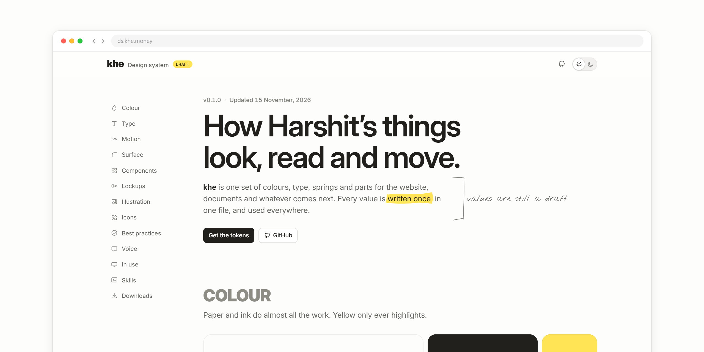
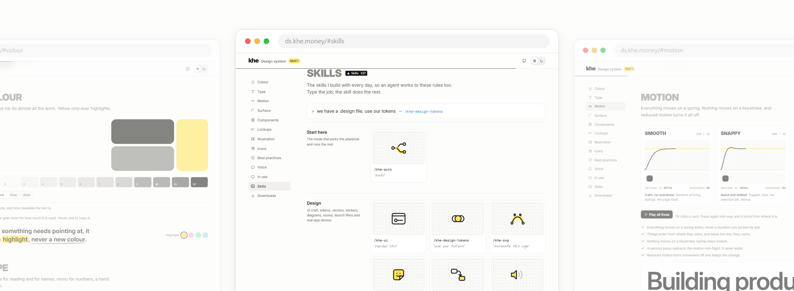

<a href="https://ds.khe.money">
  <picture>
    <source media="(prefers-color-scheme: dark)" srcset="docs/readme/hero-dark.png">
    
  </picture>
</a>

# khe

How [Harshit Khemani](https://www.khe.money)'s things look, read and move: one set of colours, type, springs and parts for [khe.money](https://www.khe.money), papers, decks and whatever comes next.

**[ds.khe.money](https://ds.khe.money)** is the brand page. Draft, v0.1.



## What's in it

- **Tokens.** `tokens/tokens.json` is the only place a value is written: sand, gray and slate greys, one yellow highlighter, Inter and Geist Mono, sizes, radii and three springs, with light and dark roles on top.
- **Components.** Button, Switch, SegmentedControl, Tabs, Menu, Dialog, Tooltip, Checkbox, Slider, CopyButton, CommandPalette and ThemeToggle. Behaviour comes from [ui-sdk](https://ui-sdk.dev/docs), the look from khe. Variants are closed and there is no `className`.
- **The page.** Colour, Type, Motion, Surface, Components, Lockups, Illustration, Icons, Best practices, Voice, In use, Skills and Downloads, every example live.
- **khe.DESIGN.** The whole system in one file for agents (schema design.v1), built from the tokens so it never drifts.

## Run it

```bash
npm install
npm run dev     # http://localhost:4680
```

`npm run tokens` rebuilds `src/styles/tokens.css` and `khe.DESIGN` from `tokens.json`.

## Use it with an agent

Point your agent at [`khe.DESIGN`](khe.DESIGN), or open [Downloads](https://ds.khe.money/#downloads), switch to **Agent** and copy the brief.

The skills I build with live in **[HKTITAN/skills](https://github.com/HKTITAN/skills)**:

```bash
npx skills add HKTITAN/skills
```

## Checks

```bash
npm run check
```

Fails if anything outside `src/components` imports ui-sdk, if a raw hex colour appears outside the tokens, or if `tokens.css` has drifted from `tokens.json`. The rules live in code, not in a doc.

## Licence

[MIT](LICENSE). The README images are filmed from the live page with the [Stageshow](https://benji.org/stageshow) kit (`npm run dev`, then `site/readme-shots.html`).
